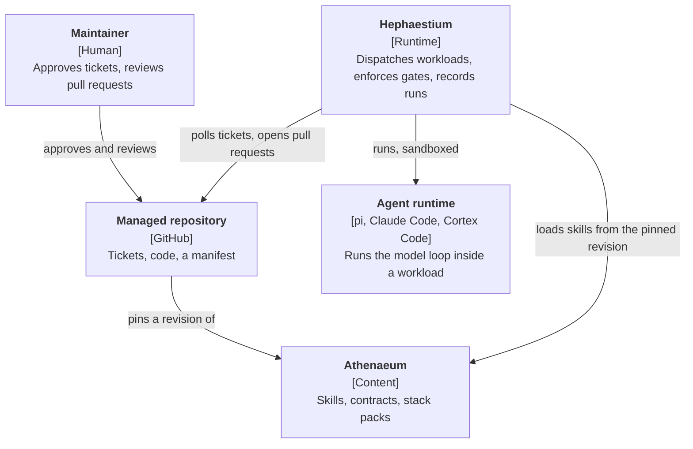

# Hephaestium

> A software factory that measures its own agents.

Hephaestium dispatches coding agents against the tickets of the repositories it
manages, runs each one as an isolated workload, and records what it did and
what it cost. Its reason to exist is the part most agent tooling leaves out:
checking, on the same tickets, whether a change to a prompt, a skill or a model
made the agents better or worse.

> **Status: early. The command-line tool can check a manifest, run a gate, lint a change and sync skills; nothing dispatches agents yet.**
> The source is publicly visible under a restrictive licence. You may read it,
> but may not use, copy or distribute it. See [LICENSE](./LICENSE).

[Why](#why) · [How it fits together](#how-it-fits-together) · [What works today](#what-works-today) · [What is different](#what-is-different) · [Planned stack](#planned-stack) · [Roadmap](#roadmap) · [Releases](#releases) · [Prior art](#prior-art) · [Feedback](#feedback) · [Licence](#licence)

## Why

Hephaestium grew out of the agent harness inside
[The Stacks](https://github.com/erinversfeldcodes/thestacks): about 17,500
lines of role specifications, skills, hooks and scripts that drive Claude Code
through planning, test-first implementation, review and completion. It was inspired by [Rameez Khan's presentation of Forge](https://github.com/rameezk/forge), but built according to my preferred tool-chain and to focus on things I care about.

The original harness works but like all software projects has areas for growth. For example, every rule in
it is an instruction to an agent, and an instruction can be skipped:

- An audit of one campaign found 42 of 43 tickets had a design review and only
  1 had the stack review the design review deferred to.
- Waves of work were reported complete when they were not.
- A feedback log every failed review was meant to append to has ten files and
  no entries.

The harness's value was demonstrated but never measured. There is no baseline
and no way to tell which of its instructions carry weight. Hephaestium is the
runtime that enforces those rules itself and measures the result.

## How it fits together



- **[Athenaeum](https://github.com/erinversfeldcodes/athenaeum) is content.**
  It holds the skills, the specialist and reviewer contracts, and a pack per
  stack. It contains no code.
- **Hephaestium is code.** It reads tickets, creates workspaces, runs agents,
  runs gates, fans out reviews and keeps the record.
- **A managed repository describes itself in a manifest:** its components, its
  gate commands, how to bootstrap a workspace and where its documents live.

The vocabulary is defined in [`docs/CONTEXT.md`](./docs/CONTEXT.md).

## What works today

`heph`, the command-line tool, checks a managed repository's manifest against
the schema published by Athenaeum, and runs the gates it declares:

```
$ heph manifest check
.athenaeum/manifest.toml: $.gates.regression: Additional properties are not allowed ('when_path' was unexpected)
```

It exits 0 for a valid manifest, 1 for an invalid or unreadable one, and 2 for
a command line it cannot understand. The schema is compiled in from a pinned
Athenaeum release, and that release's conformance cases are run as `heph`'s
own tests, so the tool cannot disagree with the contract it was built for.

`heph gate run` runs a gate the manifest declares and prints what happened as one
line of JSON that follows Athenaeum's gate result contract:

```
$ heph gate run regression
{"schema_version":0,"gate":"regression","outcome":"passed","command":["just","ci"],"exit_code":0,"duration_ms":412803}
```

It puts the manifest's toolchain wrapper in front of the command, stops the gate
and everything it started if it runs past its timeout, and skips a gate that does
not apply to the files named with `--changed`. It exits 0 if the gate passed or
was skipped, 1 if it failed or timed out, and 3 if it could not be run. See
[ADR-0011](./docs/adr/0011-a-gate-run-reports-one-line-on-stdout-and-stops-everything-it-started.md).

`heph lint` runs the lint commands of the components a change touches, each from
its component's root and under the same wrapper, and prints each as a gate result
named `lint:<component>:<n>`. Every command runs even if an earlier one fails, so
one run reports every finding. See
[ADR-0012](./docs/adr/0012-lint-commands-run-as-gates-named-for-their-component.md).

`heph sync` makes the skills a repository vendors in `.athenaeum/skills/` match its
lock, which pins an Athenaeum release by tag and commit, and links them where an
agent runtime looks. It refuses a tag that has moved and never overwrites what it
did not create. `--check` reports drift and changes nothing, and `--update` moves
the pin to a newer release. See
[ADR-0013](./docs/adr/0013-sync-vendors-the-pinned-skills-and-never-overwrites-what-it-did-not-create.md).

`heph baseline check` checks a repository's working tree against the baseline, the
list of what every repository must have, and prints a gate result named `baseline`
with an outcome for each item: satisfied, unsatisfied, excepted with a reason, not
applicable, or not checked. It answers the items that files and workflows can, and
says plainly which ones need GitHub. With `--settings` it also reads the repository's
settings and default-branch rulesets from GitHub, read-only, by running `gh`. A
`required` item that is unsatisfied fails the check. See
[ADR-0015](./docs/adr/0015-the-baseline-check-reads-the-tree-and-says-what-it-did-not-check.md)
and
[ADR-0016](./docs/adr/0016-github-is-read-through-gh-and-what-it-does-not-say-is-not-a-finding.md).

`heph baseline apply` writes the files a repository is missing, from the baseline's
templates with the repository's name, owner, licence holder and contact filled in. It
also writes a `dependabot.yml` for a repository that has none, with an entry for each
ecosystem and directory it finds; one that exists is never edited, and `heph baseline
check` names the entries it lacks. It
never overwrites a file and never writes through a link, writes nothing unless it can
write everything, and ends by saying what is still unsatisfied. `--dry-run` shows what
it would write. See
[ADR-0017](./docs/adr/0017-the-baseline-apply-writes-only-what-is-missing-and-only-when-it-can-write-all-of-it.md).

`heph baseline apply --settings` is the one command that changes GitHub: it turns on
the settings the baseline asks for and creates a default-branch ruleset where none
covers the branch. It changes nothing unless given `--yes`, prints the exact requests
first, and never modifies a ruleset that exists. See
[ADR-0018](./docs/adr/0018-changing-github-is-an-explicit-act-and-never-modifies-what-exists.md).

`heph workload TICKET` builds the workload for a ticket on the repository you are in
and prints it as JSON, which is what `executor run` takes. The repository is the
`origin` of the checkout (or `--repo`); the run starts from the tip of the default
branch on GitHub and not from your checkout, because a run clones from GitHub and sees
only what is pushed, and it warns when your checkout is somewhere else. The ticket must
be an open issue. You are the approver: the workload names the signed-in GitHub user and
the time. It changes nothing and runs nothing.

`heph run TICKET` is the one command: from inside any project it builds the ticket's
workload as `heph workload` does, runs the executor on it with delivery, shows what is
happening one line at a time (the workspace, what the agent says and does, each gate,
the pull request), and ends with the outcome, the cost and the pull request. The run is
kept in a directory of its own outside your project, under
`~/.local/state/hephaestium/runs/` (or `$XDG_STATE_HOME`), with the workload, the events,
the executor's output, the run record and the workspace. The tokens are found in the
environment or in `~/.config/hephaestium/github-token` and `claude-token`; what
each needs, and how to make it, is in [`docs/tokens.md`](./docs/tokens.md). It exits 0
if the workload completed and 1 if it ended any other way. Interrupting it (Ctrl-C, or a
termination signal) stops the agent and everything it started, and the run ends
`cancelled`, with its record written.

`executor run` runs one workload, which is a message the contracts under
[`proto/`](./proto) define: it clones the repository at the workload's base commit,
runs the manifest's `bootstrap` steps in it, plays what the agent did, and says all of
it as events, one JSON object to a line on standard output, ending with a run record.
After the agent it runs every gate the manifest declares, in the workspace, and says
what each did; the workload is completed only if none failed, so nothing rests on the
agent's own word. The agent runs as a process behind an adapter, in an environment
holding only the variables the adapter names, and is stopped, with everything it
started, at the workload's timeout or when it has spent its budget; a workload with
no timeout or no budget is refused. A Claude Code workload runs Claude Code, with an
empty configuration directory of its own and a token made for it, so nothing of the
maintainer's own setup reaches it; the other runtimes have no adapter yet, and a stub
stands in for any of them (`--transcript` or `--agent-command`, for development).
With `--deliver`, a workload whose gates passed is committed on a branch of its own,
pushed, and opened as a pull request; that step alone holds the token that can push
(`HEPH_GITHUB_TOKEN`), which the bootstrap steps, the gates and the agent never see.
Each secret (that token, and `CLAUDE_CODE_OAUTH_TOKEN` for a Claude Code agent) is the
variable of its name or the contents of the file its `_FILE` variable names, kept
outside any repository with mode 600; the executor takes it at start and removes both
from its environment. It exits 0 if the workload ran to an outcome, whatever it was, and 1 if it could not
be run.

## What is different

1. **Gates are run by the runtime, not requested in a prompt.** A workload is
   done when Hephaestium has seen the evidence, not when the agent says so.
2. **Test custody.** The tests for a ticket are written by one workload and
   mounted read-only into the workload that implements it, so an agent cannot
   go green by weakening a test.
3. **Reviews are selected by the diff.** Hephaestium works out which review
   lenses a change needs from the paths it touches, pins each review to a
   commit, and refuses to call the work done while a required verdict is
   missing.
4. **Controlled comparison.** A frozen corpus of past tickets, each pinned to
   its base commit, is replayed under two configurations so that a change to
   the harness is compared on the same work.
5. **Three agent runtimes.** `pi` through OpenRouter, Claude Code, and
   Snowflake Cortex Code, each behind one adapter contract and one event
   schema.

## Planned stack

| Part | Choice | Why |
|---|---|---|
| Control plane | Elixir, OTP, Oban, Postgres | A workload is a supervised process; dispatch, revision and settlement are durable jobs. |
| Executor and command-line tool | Rust | One small binary that sets up the sandbox, runs gates and streams events. |
| Replay and evaluation | Python | Replays the corpus and reports paired results with cost. |
| Contracts | Protobuf and buf | One schema for transcript events, gate results and the adapter contract, generated into every language. |
| Dashboard | TypeScript and React | A read-only client of the same API, with a generated client and a streaming transcript. |
| Tracing | OpenTelemetry | A workload is a span. |

Multilanguage projects are the bane of some, but not me :) I personally enjoy using the right tool for the job and projects like this and tech like LLMs make it easier to work in. The decisions behind each language choice is in [`docs/adr/`](./docs/adr).

## Roadmap

| Phase | Outcome |
|---|---|
| 0 | The Stacks' tickets and plans are backed up and a replay corpus is frozen, before the harness changes. |
| 1 | Athenaeum's layout, the manifest schema, and a command-line tool that validates a manifest and runs a gate. The Stacks consumes the first portable skills. |
| 2 | The specialist and reviewer contracts are stated once, and each stack becomes a pack. |
| 3 | The long role specifications are split into a short persona, its instruments and its modes. |
| 4 | The Stacks is cut over: tickets move to GitHub issues and the original harness is deleted from it. |
| 5 | The runtime takes the gates, one at a time, each proved against the replay corpus. |
| 6 | The harness itself is measured: which skills a run loaded, and what happens when one is changed. |

## Releases

A version is derived from the conventional commits on `main`: a breaking change
bumps the major version, `feat` the minor, and `fix` or `perf` the patch. When
the checks pass on `main` and those commits warrant it, a workflow creates the
`v<version>` tag and a GitHub release. The version is compiled into each
artefact as it is built and attached to that release; it is never committed, so
there is no version file and no changelog file. The
[releases](https://github.com/erinversfeldcodes/hephaestium/releases) are the
changelog. Each release attaches a `heph` binary for Linux and macOS. See [ADR-0008](./docs/adr/0008-versions-come-from-conventional-commits.md).

## Prior art

[Forge](https://github.com/rameezk/forge) by Rameez Khan is the closest
existing system and the reason this one has the shape it does. Hephaestium
takes several ideas from it: workloads in a sandbox, a per-run configuration
fingerprint, skills held in their own repository and synced with a lock file,
and reviews pinned to a commit. No Forge code is included here.

## Feedback

Bug reports and ideas are welcome as issues. Pull requests from outside are not
accepted. See [CONTRIBUTING.md](./CONTRIBUTING.md) and
[SECURITY.md](./SECURITY.md).

## Licence

Source-available, all rights reserved. See [LICENSE](./LICENSE).

## Why the name

Hephaestus was the Greek god of the forge and of craftsmen, and a Hephaestium
is a place dedicated to him. The skills it works from live in an
[athenaeum](https://github.com/erinversfeldcodes/athenaeum), a place dedicated
to Athena, with whom he shared a temple in Athens. And of course as a god of the forge, Hephaestus knew how to bliksem his tools into shape.
